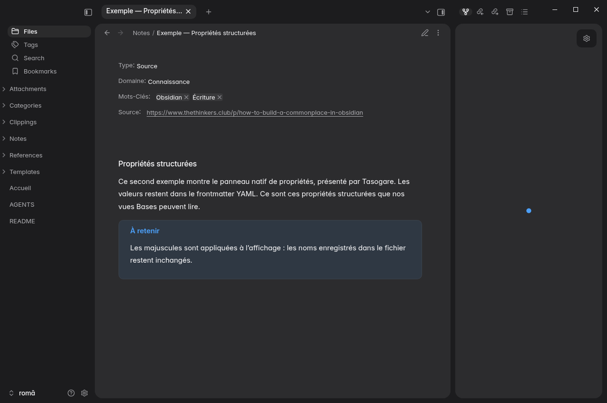

# Tasogare

Un thème Obsidian calme : une carte de note dans un cadre de 10 px, sept palettes et une typographie Inter commune au clair et au sombre.

La version 1.9.0 est une **version candidate**. La publication d’une release reste distincte de la préparation du code.



## Installer

La version publiée s’installe dans **Apparence → Thèmes → Gérer**. Pour un essai local, placer le dossier contenant `theme.css` et `manifest.json` dans `.obsidian/themes/Tasogare`, puis sélectionner Tasogare.

Le thème fonctionne sans plugin communautaire. **Style Settings**, facultatif, permet de choisir une palette et de réafficher la barre d’état, les commandes du navigateur de fichiers ou les icônes de propriétés. Sans lui : Graphite et interface épurée.

## Utiliser

- **Notes** : colonne de lecture de 640 px. Le réglage de taille de police d’Obsidian reste prioritaire ; la base 15 restitue l’échelle typographique de référence.
- **Bases** : les fichiers `.base` gardent leurs vues et leurs contrôles natifs. Le ratio des images se règle dans chaque vue. Les tableaux disposent d’une marge intérieure, d’un en-tête teinté et de séparations lisibles, issus des rôles du thème.
- **Pages de collection** : ajouter `wide` à la propriété native `cssclasses` pour une note large, y compris sa Base intégrée.
- **Propriétés** : champs natifs éditables, libellé ajusté à son texte et valeur placée après les deux-points sur ordinateur. Les clés YAML restent intactes.
- **Panneaux** : les sidebars se replient et se redimensionnent normalement. Leur contenu et l’ordre des onglets appartiennent au coffre.

```yaml
cssclasses: [wide]
```

Les palettes sont Graphite, Crépuscule alpin, Grès rosé, Thé vert, Lac profond, Porte bleue et Galet noir. Leurs valeurs et contrastes sont documentés dans [les couleurs](docs/couleur-obsidian.md). Les autres fondations sont décrites dans [docs](docs/README.md).

## Construire

`theme.css` est la seule source de style et le fichier directement lu par Obsidian. Il comporte trois couches :

1. **Données** : palettes, échelle typographique et mesures.
2. **Rôles** : variables natives d’Obsidian alimentées par ces données.
3. **Composants** : règles limitées au cadre, aux onglets, à la navigation, aux propriétés et aux surfaces.

Aucune compilation, aucun JavaScript d’affichage et aucun fragment CSS additionnel ne sont nécessaires. Les contrôles et icônes restent natifs. La barre d’état, si elle est affichée, s’ancre à une carte par CSS ; aucune largeur de sidebar n’est recopiée. Les règles de bureau sont séparées de la disposition mobile.

## Vérifier

```bash
python3 outils/verifier.py
python3 -m unittest discover -s outils -p 'test_*.py'
git diff --check
```

Ces contrôles couvrent les variables, les déclarations répétées, les ressources distantes, les valeurs brutes hors des fondations, la portée des propriétés, les contrastes et la documentation des palettes.

Les versions des outils de développement sont fixées dans `requirements-dev.txt` (`python3 -m pip install -r requirements-dev.txt`). Le test d’interface utilise Playwright et une instance **isolée** d’Obsidian 1.15 avec un port CDP, une interface anglaise et zéro plugin communautaire :

```bash
python3 outils/verifier-interface.py \
  --cdp http://127.0.0.1:9231 \
  --coffre /chemin/du/coffre-de-test \
  --minimal /chemin/du/theme/Minimal \
  --sortie /chemin/des/resultats
```

Le test crée ses trois fiches et sa Base, puis les supprime. Il vérifie les palettes, seize dispositions, les propriétés longues et leur édition, la largeur des pages et la parité avec Minimal : vues, tri, recherche, filtres, édition des cellules, ouverture et onglets empilés. Les fichiers Markdown préexistants doivent rester identiques. L’option `--reference /chemin/avant.css` compare aussi les couleurs et la typographie au thème précédent.

[AGENTS.md](AGENTS.md) porte le contrat de revue. Les tests sous Linux ne valident pas une installation sur Mac ni un appareil mobile réel.

## Crédits et licence

La structure des palettes et la navigation avec libellés s’inspirent de Minimal de Steph Ango, sous licence MIT ; la [notice](licences/minimal.txt) est incluse. Les fondations décrivent leurs autres sources. Tasogare est distribué sous [licence MIT](LICENSE).
