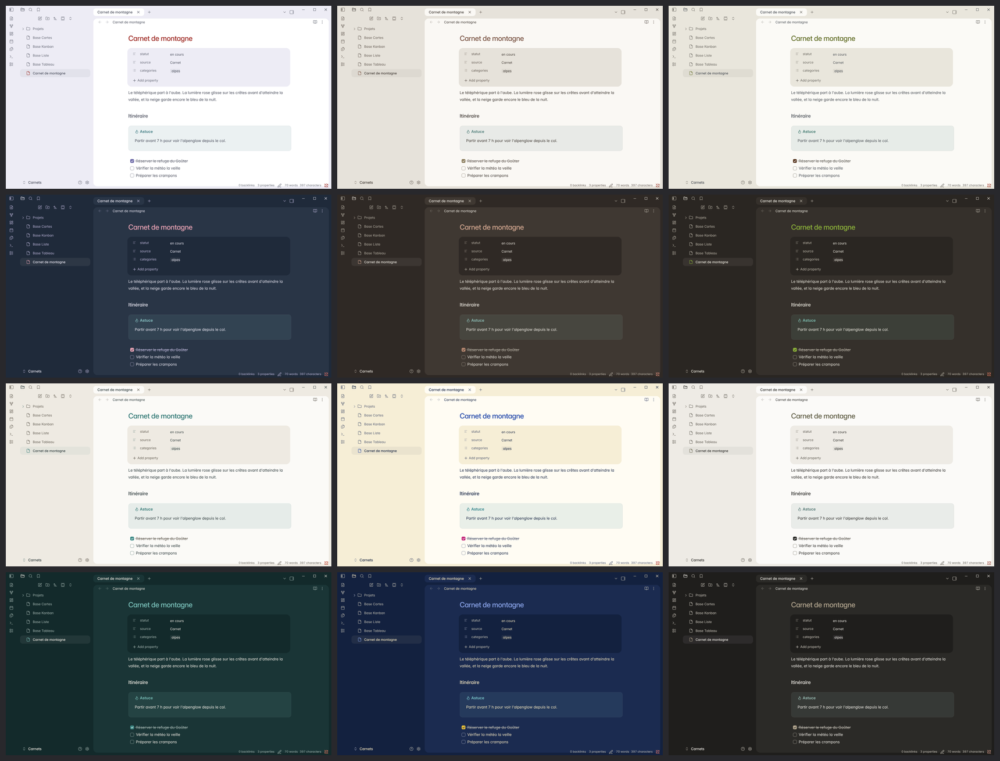

# Tasogare

黄昏, tasogare : le crépuscule, en japonais. Un thème Obsidian calme : une carte de note arrondie dans un cadre nu, sans séparateurs, avec un inset unique de 10 px, en clair comme en sombre.



## Installer

1. Dans Obsidian, ouvre Réglages → Apparence → Thèmes → Gérer.
2. Cherche **Tasogare**, puis choisis Installer et utiliser.
3. Facultatif : installe le plugin communautaire **Style Settings** pour choisir la palette.
4. Règle Apparence → Taille de police sur 15 pour l'échelle typographique exacte.

## Interface

Tasogare propose une navigation gauche avec libellés, un panneau droit arrondi avec le même inset que la note et des propriétés sur le fond de note, sans icônes de type. Sur ordinateur, chaque valeur suit directement son libellé et ses deux-points. Les clés gardent leur taille intrinsèque, plafonnée à la moitié de la rangée ; les valeurs peuvent passer à la ligne sur une fenêtre étroite. Les capitales ne changent que l’affichage des clés ; l’ajout de propriété reste accessible au survol et au clavier. Les callouts `note` gardent leur encadré sans icône. Les sept palettes et toute l’échelle typographique restent celles de Tasogare.

La disposition des onglets relève du coffre : Fichiers, Tags, Recherche et Favoris à gauche ; graphe local, liens entrants, liens sortants, propriétés et plan à droite. Chaque sidebar garde son bouton natif de repli. Le thème masque par défaut la barre d’état et les commandes du navigateur de fichiers sur ordinateur. Style Settings peut les réafficher, ainsi que les icônes des propriétés. Sans ce plugin, l’interface fonctionne avec ses valeurs par défaut. Les barres de défilement gardent le comportement Tasogare : visibles au survol.

## Modules et réglages

- **Aucun plugin communautaire obligatoire.** Le thème porte les insets, les onglets, les libellés de navigation et la présentation des propriétés et encadrés.
- **Modules natifs d’Obsidian** : Graphe, Liens entrants, Liens sortants, Propriétés, Plan, Tags, Recherche, Favoris et Bases fournissent leurs vues. Activer les modules souhaités puis ranger leurs onglets dans les sidebars ; leur ordre appartient au coffre, pas au thème.
- **Style Settings, facultatif** : choix de palette et options d’affichage. Sans lui : Graphite et interface épurée.
- **Hider et Minimal Theme Settings ne sont pas nécessaires.** Les autres plugins de l’article restent des choix de workflow, pas des dépendances du thème.
- Pour retrouver la disposition de la démonstration, le coffre de test fournit `workspace.json` et le réglage natif qui masque le ruban. Le thème seul conserve l’organisation du coffre dans lequel il est installé.

## Palettes

Sept palettes, chacune en clair et en sombre. Graphite, neutre avec un accent bleu, sert de base. Les six autres font le tour du cercle des couleurs : une palette par famille, pour qu'aucune ne double une autre.

- **Graphite** (par défaut, gris neutres et bleu) : Graphite `#1C1C1E`, Brume `#F2F2F7`, Pierre `#636366`, Argent `#8E8E93`, Trait `#D1D1D6`, Bleu lien `#0066CC`, Bleu action `#0071E3`, Bleu ciel `#4DA3FF`.
- **Crépuscule alpin** (violet et rouge) : Cabine rouge `#9E2B25`, Ciel lavande `#6E6BA8`, Alpenglow `#E8A3B4`, Neige d'ombre `#B9B3D6`, Lueur `#F4C66A`, Câble acier `#4A4E5C`, Sapin nuit `#1F2A3A`.
- **Grès rosé** (terre) : Grès rosé `#B98A72`, Chaux `#E6E2DA`, Travertin `#D3C7B2`, Olivier sec `#8C7E5E`, Ombre douce `#B4AEA2`, Argile cuite `#7A5443`, Encre taupe `#3F3832`.
- **Thé vert** (vert) : Matcha vif `#8DB33A`, Noyer usé `#5B3A24`, Céramique noire `#2A2622`, Mousse `#6E7A2C`, Jour pâle `#E9E6DC`, Laiton `#C2A25A`, Lin ardoise `#4A4F55`.
- **Lac profond** (bleu-vert) : Bouée rouge `#D2452B`, Lac profond `#1F5A5C`, Turquoise lac `#3E8A86`, Brume montagne `#7E9590`, Chanvre `#C8AE7E`, Écume `#EEEAE2`, Ponton gris `#6F685E`.
- **Porte bleue** (bleu) : Bleu cobalt `#2347A8`, Mur safran `#E6BE3A`, Bougainvillier `#C2287A`, Terracotta `#C0663E`, Cactus `#5E8B4A`, Zellige `#F0E3BE`, Nuit bleue `#13213F`.
- **Galet noir** (neutre) : Galet noir `#2B2A27`, Plâtre `#C9C4BA`, Lin avoine `#B3A68F`, Porcelaine `#EEEBE5`, Pierre grise `#8E8A80`, Fumée `#5F5B53`, Mousse sèche `#7D7A5E`.

Chaque palette garde un fond neutre ; sa couleur forte va à l'accent, aux boutons et aux signaux. Le titre et les liens portent la couleur de la famille ; quand elle est trop claire ou trop sombre pour du texte, elle est assombrie ou éclaircie à cet emplacement, sans changer de teinte.

Le choix se fait dans Réglages → Style Settings → Tasogare → Palette. Sans le plugin, le thème reste complet, avec Graphite.

Chaque palette passe les seuils de contraste WCAG AA (4,5:1 pour les liens et le texte secondaire), et son texte courant atteint au moins 7:1.

## Typographie

Le thème suit la spécification [Typographie 1.1](docs/typographie.md) : titre 28 / 500, h2 19 / 500, texte 15 px avec un interligne de 1,75. La police est Inter, embarquée par Obsidian : rien à installer. Le détail de la correspondance avec les variables d'Obsidian est dans [docs/typographie-obsidian.md](docs/typographie-obsidian.md).

À une taille de police de 15, chaque rôle tombe sur la valeur exacte de la spécification ; une autre valeur agrandit ou réduit toute l'échelle, sans changer ses proportions.

## Design system

Le thème repose sur quatre fondations : couleur, typographie, espace et forme, mouvement. Chacune a une spécification réutilisable et un document qui la relie aux variables d'Obsidian. Le sommaire est dans [docs/README.md](docs/README.md).

Les tableaux Markdown et ceux de Bases reprennent les surfaces du thème : rayon de bloc, contour discret et ombre posée. Les tableaux des notes gardent des séparations horizontales et les alignements écrits en Markdown. Le défilement et les contrôles d’édition restent gérés par Obsidian.

Sur ordinateur, la barre d’état flotte dans l’angle inférieur droit de la carte centrale, sur le même fond. Lorsqu’elle est affichée, son ancrage CSS suit l’ouverture et le redimensionnement des sidebars ; elle ne crée aucun bandeau sous les panneaux et laisse l’inset libre.

Pour vérifier le thème après un changement (variables, couleurs, contrastes, docs) :

```bash
python3 outils/verifier.py
```

## Vérifier l’interface native

`outils/verifier-interface.py` pilote une instance **isolée** d’Obsidian 1.15 avec un port CDP et le coffre de démonstration. Il exige zéro plugin communautaire chargé et vérifie que le chemin du coffre correspond à celui fourni. Installer Playwright dans l’environnement de test, puis lancer :

```bash
python3 outils/verifier-interface.py --cdp http://127.0.0.1:9230 --coffre /chemin/du/coffre-de-test --sortie /chemin/des/resultats
```

Le coffre de test contient les deux notes Exemple, les cinq panneaux natifs à droite et la Base Bibliothèque du lot romā à 155 fiches. Le script compare couleurs et typographie avec la référence `5653884` du dépôt, teste les sept palettes dans les deux modes, seize dispositions, le repli et le redimensionnement, les options d’affichage et les vues tableau et cartes. Le coffre de démonstration utilise des visuels paysage 1080 × 720 ; son `imageAspectRatio` vaut 2/3 (hauteur / largeur) dans les vues cartes, pour éviter un cadre portrait vide autour de ces images. Le thème respecte le ratio choisi par la Base. Il conserve les fiches et exporte les captures et le rapport JSON. Le test de palettes applique leurs classes CSS directement ; il ne nécessite pas Style Settings. Les contrôles de géométrie s’effectuent après la fin des transitions natives.

`outils/verifier-proprietes.py` utilise les mêmes arguments sur ce coffre isolé. Il crée puis supprime sa note temporaire et vérifie les libellés longs, URL, listes, champs vides, cases à cocher, nombres, fenêtres étroites, édition d’une valeur et renommage d’une clé dans le YAML. Les règles d’alignement ciblent uniquement le bloc natif de propriétés ; les tableaux et cartes de Bases conservent leur grille.

Ce test sous Linux ne valide pas une exécution sur macOS ni sur téléphone.

## Adapter

- **Couleurs et mesures** : elles vivent dans la couche 1 de `theme.css` (`--tasogare-*`). Une palette remplit les mêmes emplacements (`--tasogare-cadre`, `--tasogare-encre`, `--tasogare-accent`…) ; les règles ne lisent que des rôles.
- **Icônes des propriétés (facultatif)** : active d’abord leur affichage dans Style Settings → Tasogare → Interface. Le snippet `snippets/tasogare-icones-proprietes.css` donne une icône à une clé de propriété précise (`statut`, `source`…). Copie-le dans le dossier `.obsidian/snippets/` de ton coffre, puis active-le dans Réglages → Apparence → Snippets CSS. Une clé absente garde l'icône de son type.

## Crédits

Le défilement révélé au survol et les filets des fenêtres s'inspirent du thème Border (Akifyss/obsidian-border). La structure des palettes en emplacements et la navigation avec libellés s’inspirent du thème Minimal (kepano/obsidian-minimal, licence MIT ; notice dans `licences/minimal.txt`). Les règles de mouvement viennent des skills d'Emil Kowalski (emilkowalski/skill, licence MIT) et de l'article « Using Gestures in Motion » de Jakub Krehel. Certaines règles de hiérarchie, d'alignement et de mouvement composé s'inspirent d'Interface Craft (Josh Puckett), reformulées.

## Licence

MIT, voir `LICENSE`.
