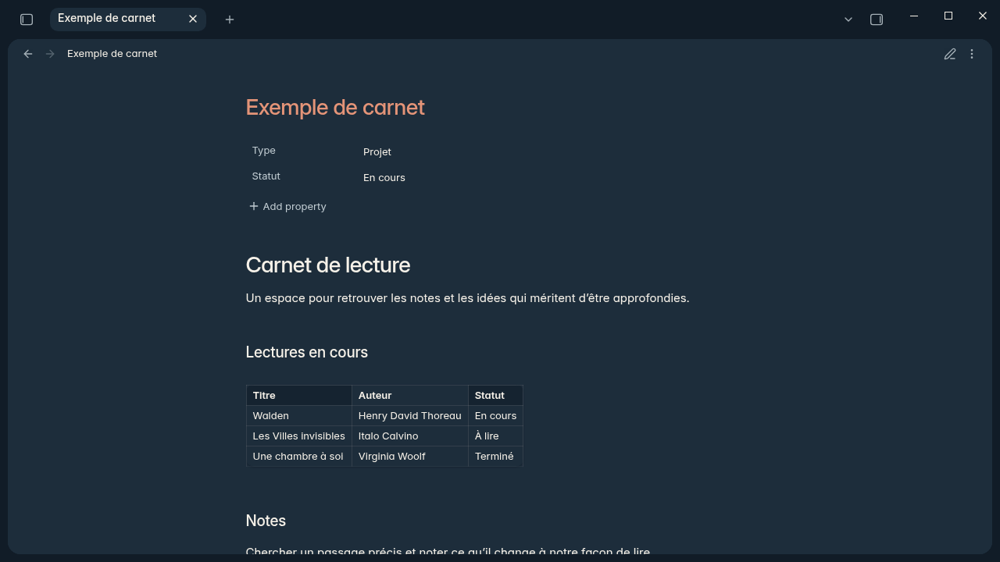

# Tasogare

Un thème Obsidian calme : une carte de note dans un cadre de 10 px, neuf palettes et une typographie Inter commune au clair et au sombre.



## Installer

La version publiée s’installe dans **Apparence → Thèmes → Gérer**. Pour un essai local, placer le dossier contenant `theme.css` et `manifest.json` dans `.obsidian/themes/Tasogare`, puis sélectionner Tasogare.

Le thème s’applique directement dans Obsidian. Crépuscule japonais est la palette par défaut. Sur ordinateur, le badge des rétroliens apparaît au survol ou au focus.

## Utiliser

- **Notes** : colonne de lecture de 640 px. Le réglage de taille de police d’Obsidian reste prioritaire ; la base 15 restitue l’échelle typographique de référence.
- **Bases** : les fichiers `.base` gardent leurs vues et leurs contrôles natifs. Le ratio des images se règle dans chaque vue. Les tableaux disposent d’une marge intérieure, d’un en-tête teinté et de séparations entre les lignes et les colonnes, issus des rôles du thème.
- **Pages de collection** : ajouter `wide` à la propriété native `cssclasses` pour une note large, y compris sa Base intégrée.
- **Propriétés** : champs natifs éditables, valeurs alignées sur une colonne et bouton d’ajout visible. Obsidian empile les libellés et les valeurs quand la note devient étroite.
- **Ouvrir une fiche à côté** : utiliser **Ouvrir dans un nouveau volet** dans le menu du lien. Le thème applique les mêmes surfaces et espacements aux volets natifs.
- **Panneaux** : le bouton de repli se trouve sur la ligne des onglets. L’aide et les réglages restent sur la ligne du sélecteur de coffre. Le panneau reste redimensionnable dans Obsidian.

```yaml
cssclasses: [wide]
```

Crépuscule japonais reprend les tons du lac Ashi à l’heure bleue. Larch emprunte l’or du mélèze. Les deux palettes et Graphite utilisent des cartes blanches et un cadre gris neutre en mode clair. Les neuf palettes et leurs contrastes sont détaillés dans [les couleurs](docs/couleur-obsidian.md).

## Extension facultative Yoi

Yoi ouvre les fiches des Bases dans un tiroir éditable, dans le même onglet. C’est une extension pour Obsidian de bureau 1.15 ou ultérieur, compatible avec Tasogare et le thème par défaut. Elle s’installe manuellement. [Télécharger Yoi 0.4.0](https://github.com/antoineberjoan/tasogare/raw/refs/heads/main/extras/yoi/Yoi-0.4.0.zip) · [Installation et code](extras/yoi)

## Construire

`theme.css` est la seule source de style et le fichier directement lu par Obsidian. Il comporte trois couches :

1. **Données** : palettes, échelle typographique et mesures.
2. **Rôles** : variables natives d’Obsidian alimentées par ces données.
3. **Composants** : règles limitées au cadre, aux onglets, à la navigation, aux propriétés et aux surfaces.

Aucune compilation, aucun JavaScript d’affichage et aucun fragment CSS additionnel ne sont nécessaires. Sur ordinateur, la barre d’état suit le volet actif par ancrage CSS. Obsidian place le menu du coffre et les fragments CSS peuvent surcharger le thème. [Recommandations officielles pour les thèmes](https://docs.obsidian.md/Themes/App+themes/Theme+guidelines)

## Vérifier

```bash
python3 outils/verifier.py
python3 -m unittest discover -s outils -p 'test_*.py'
git diff --check
```

Ces contrôles couvrent les variables, les déclarations répétées, les ressources distantes, les valeurs brutes hors des fondations, la portée des propriétés, les contrastes et la documentation des palettes.

Les versions des outils de développement sont fixées dans `requirements-dev.txt` (`python3 -m pip install -r requirements-dev.txt`). Le test d’interface utilise Playwright et une instance **isolée** d’Obsidian 1.15 avec un port CDP, une interface anglaise et zéro plugin communautaire :

```bash
python3 outils/verifier-interface.py \
  --cdp http://127.0.0.1:9231 \
  --coffre /chemin/du/coffre-de-test \
  --minimal /chemin/du/theme/Minimal \
  --sortie /chemin/des/resultats
```

Le test crée ses trois fiches et sa Base, puis les supprime. Il vérifie les palettes, seize dispositions, l’ouverture et le placement natifs du menu du coffre, les rétroliens dans le volet actif, les propriétés longues et leur édition, la largeur des pages et la parité des interactions des Bases avec Minimal. Les fichiers Markdown préexistants doivent rester identiques. L’option `--reference /chemin/avant.css` compare aussi les couleurs et la typographie au thème précédent.

[AGENTS.md](AGENTS.md) porte le contrat de revue. Les tests sous Linux ne valident pas une installation sur Mac ni un appareil mobile réel.

## Publier

Le tag doit correspondre à la version du manifeste. Un tag ordinaire crée un brouillon. Un tag annoté dont le sujet est `Publier Tasogare <version>` publie la release après validation du thème et ajout de `manifest.json` et `theme.css`.

## Crédits et licence

La structure des palettes et la navigation avec libellés s’inspirent de Minimal de Steph Ango, sous licence MIT ; la [notice](licences/minimal.txt) est incluse. Les fondations décrivent leurs autres sources. Tasogare est distribué sous [licence MIT](LICENSE).
