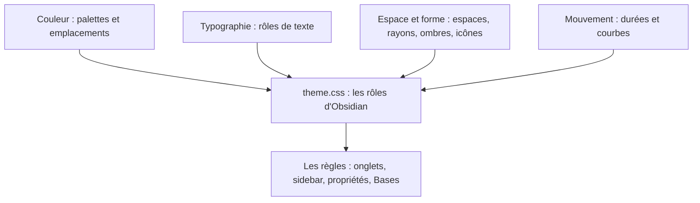

# Design system

Ce dossier décrit le design system de Tasogare. Il a deux étages :

- **Les fondations**, réutilisables dans n'importe quel projet : quatre spécifications, chacune avec son CSS prêt à enregistrer.
- **Leur application dans Obsidian** : un document par fondation, qui relie chaque jeton à une variable d'Obsidian. Le code de Tasogare (`theme.css`) fait foi.

*À lire ainsi : les quatre fondations alimentent les rôles du thème ; les règles du thème ne lisent que ces rôles.*

## Les fondations

| Fondation | Spécification | Dans Obsidian |
| --- | --- | --- |
| Couleur | [couleur.md](couleur.md) | [couleur-obsidian.md](couleur-obsidian.md) |
| Typographie | [typographie.md](typographie.md) | [typographie-obsidian.md](typographie-obsidian.md) |
| Espace et forme | [espace-forme.md](espace-forme.md) | [espace-forme-obsidian.md](espace-forme-obsidian.md) |
| Mouvement | [mouvement.md](mouvement.md) | [mouvement-obsidian.md](mouvement-obsidian.md) |

## Ce qui complète les fondations

Les fondations ne suffisent pas à faire un design system complet. Il faut aussi :

- **Les composants** : comment les jetons s'assemblent en un onglet, une carte, un tag, un callout. Dans Tasogare, c'est la couche 3 de `theme.css`.
- **L'accessibilité** : contrastes (vérifiés par `outils/palettes.py`), focus au clavier, préférence « réduire les animations ».
- **Le contenu** : le ton des textes, les messages d'erreur, les états vides. Obsidian les écrit lui-même ; un autre projet doit les définir.

## Règles communes aux quatre fondations

1. Une seule source de jetons par projet. Un export est généré, jamais maintenu à la main.
2. Trois couches : primitives (valeurs brutes), rôles (un usage écrit), consommateurs (ne lisent que des rôles).
3. Chaque projet adopte une version de chaque fondation de façon explicite.
